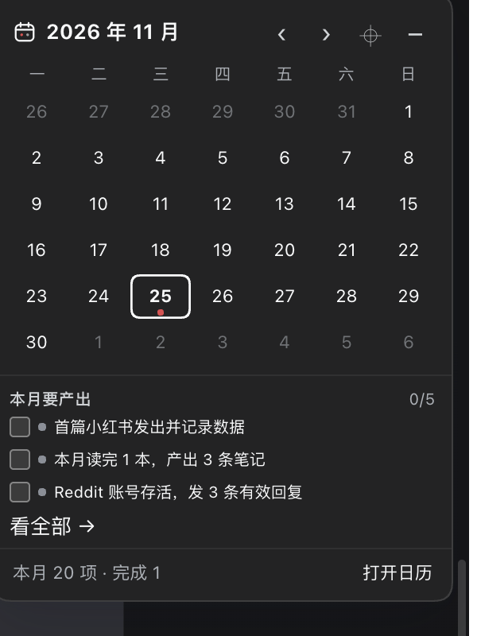

# dsh-calendar-board

DeepSeek Harness 主界面上的项目日历：右下角一张迷你月历，点开是月 / 周 / 日三视图；任务按项目分组，点一下就能跳进对应聊天。



## 它解决什么

不是“又一个待办列表”。它解决的是三件事：

1. **今天到底做什么**：缩图只有今天一个红点，节日/节点单独用黄点/绿点，不再被“有任务”淹没。
2. **这个月要交出什么**：缩图和大日历右侧都列「本月要产出」，按项目分组，可勾选。
3. **这件事找谁做**：任务详情里点「打开聊天」，把标题、项目、日期、产出、备注和来源一起带进新会话；已有 `sessionId` 的直接回到原会话。

## 功能

- **迷你月历**：可拖动、可收起、可复位；今天唯一红点；节点黄/绿点；本月目标前三条可直接勾选。
- **大日历**：月 / 周 / 日三视图；周一起始；每格任务 chip + `+N`；节点标签。
- **多项目**：`half` / `reading` / `ftc` / `x` / `local` / `other` 六个固定项目，月/周/日/右侧栏按项目色分组。
- **日视图满宽**：每个项目一组，组内是自适应卡片网格，不是一条窄长列。
- **本月产出**：按项目列 `done/total`、进度条、目标；可新增目标。
- **任务操作**：完成/撤销、打开聊天、编辑、删除；完成即变灰+删除线。
- **单一事实源**：数据是普通 JSON；Agent、Git、任何 AI 工具都能读。
- **30 秒轮询**：UI 不缓存任务，写完用返回的 plan 立即重绘。

## 安装

### 方式 A：用 `dsh plugin add` 装 Release tarball

若你的 DSH 环境提供 `dsh` CLI（本机 DSH 桌面版没有暴露该命令，未实测）：

```bash
dsh plugin add https://github.com/zhangxihuan666/dsh-calendar-board/releases/download/v0.1.2/dsh-calendar-board-0.1.2.tgz
```

### 方式 B：作为 DSH bundle 安装

把仓库克隆到本地：

```bash
git clone https://github.com/zhangxihuan666/dsh-calendar-board.git
```

在 DSH 里对 agent 说：

```text
把 /absolute/path/to/dsh-calendar-board 安装为 bundle
```

或调用：

```json
{ "action": "install_bundle", "target": "/absolute/path/to/dsh-calendar-board" }
```

安装后**重启 DSH**。替换已安装包时，Host JS 和 Client JS 都只在重启后重新加载。

### 方式 C：作为 Skill 使用

根目录的 `SKILL.md` 是给 Agent 看的操作说明。把它所在的目录复制到 DSH 的 skills 目录：

```bash
mkdir -p ~/.dsh/skills/dsh-calendar-board
cp SKILL.md ~/.dsh/skills/dsh-calendar-board/SKILL.md
```

之后 Agent 在排期、看今天、做月度盘点时会自动读它。Skill 负责“怎么读写数据”，bundle 负责“界面上看得见”；两个可以单独用。

## 数据

默认：

```text
~/Desktop/calendar/plan.json
```

覆盖顺序：

1. 插件配置 `dataFile`
2. 环境变量 `DSH_CALENDAR_FILE`
3. 默认路径

推荐让项目仓库做单一事实源：

```bash
mkdir -p ~/Desktop/calendar
ln -sf "/path/to/project/calendar/plan.json" ~/Desktop/calendar/plan.json
```

完整字段、枚举、写入规则见 [SKILL.md](SKILL.md)；交互与实现细节见 [docs/DETAIL.md](docs/DETAIL.md)。

## HTTP 接口

只接受同源 POST；浏览器内请求会自动带 DSH 的 auth cookie。

| 路径 | body | 说明 |
|---|---|---|
| `/calendar/api/load` | `{}` | 读整份 plan |
| `/calendar/api/upsert` | `{ task }` | 新增或按 id 覆盖任务 |
| `/calendar/api/remove` | `{ id }` | 删除任务 |
| `/calendar/api/toggle` | `{ id, done }` | 完成 / 撤销 |
| `/calendar/api/goal-toggle` | `{ id, done }` | 目标完成 / 撤销 |
| `/calendar/api/goal-upsert` | `{ goal }` | 新增或覆盖目标 |

统一返回 `{ ok: true, result: { plan } }` 或 `{ ok: false, error: { code, message } }`。

## 设计取舍

- 用 `shell.overlay`，不用 `conversation.composer.dock`：后者是 session 作用域，空会话首屏不存在。
- 不替换 `conversation.hero.workspace`：它被 workspace chooser 占用。
- 不用 iframe：React 组件直接注册进槽位。
- 不用 `localStorage` 存任务：数据必须能被 Agent 和 Git 看见。
- 红点只标今天，节点独立成 `markers`，不跟任务状态混在一起。
- 项目用固定枚举，保证三处视图的分组顺序和颜色一致。

## 已验证 / 未验证

已验证：

- 缩图真实渲染：只有今天一个红点；「本月要产出」3 条；底部统计；拖动/收起/复位按钮存在。
- Host 路由：`load` / `upsert` / `toggle` / `remove` / `goal-upsert` 单测通过；非法输入 400。
- 数据层：33 tasks / 9 goals / 5 markers 读回一致。
- `node --check index.js` / `client.js` 通过。

未验证：

- 大日历的完整视觉截图；本机没有可用的浏览器自动化，不拿 mock 图冒充。
- 真实点击「打开聊天」后的落点。
- 窄屏下日视图的换行效果。

## 开发

```bash
node --check index.js
node --check client.js
```

## License

MIT
