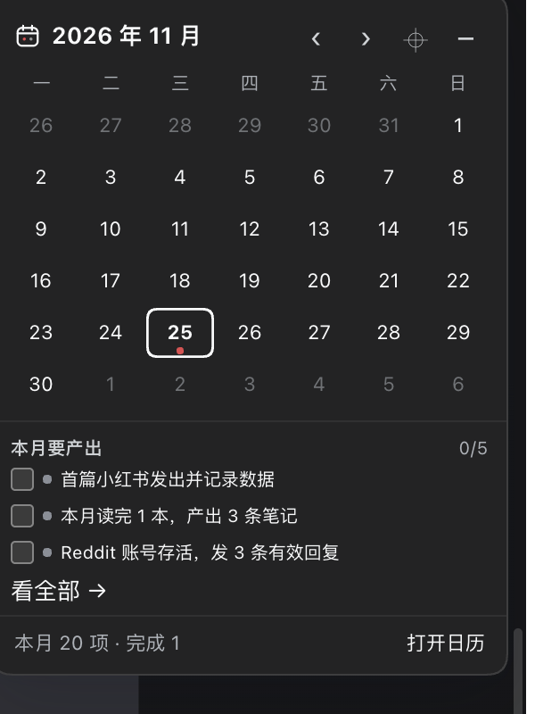

# 交互与实现细节

## 一句话

把「今天要做什么」和「这个月要交出什么」放在 DSH 主界面上：缩图看今天，大图看月/周/日，任务点开就能进聊天。



## 交互逻辑

### 第一层：右下角缩图

常驻在主界面右下角，可拖动、可收起、可复位。

- **今天**：只有一个红点，日期加环形高亮。
- **节点**：`markers` 里的日期显示黄点（节日）或绿点（里程碑）。
- **本月要产出**：显示本月 `goals` 的前三条，左侧复选框可直接完成/撤销。
- **看全部**：打开大日历。
- **打开日历**：同上，入口更明显。
- **上/下月**：只改缩图的月份，不影响大日历当前选择。
- **折叠**：收成一个小条，保留日期和入口。

缩图不绑定“当前会话”。它活在 `shell.overlay` 这个 root 作用域槽位里，所以空会话首屏、已有会话、插件页都能看见。

### 第二层：大日历

点缩图或某一天打开，是一个覆盖层，不跳路由。

```text
┌────────────────────────────────────────────────────────────┐
│ 2026 年 11 月        ‹ 今天 ›        月  周  日        ×  │
├───────────────────────────────────┬────────────────────────┤
│                                   │ 本月产出               │
│  月视图 / 周视图 / 日视图          │  半封信   1/4  ▓▓░░    │
│                                   │  阅读     0/3  ░░░░    │
│  每格：任务 chip + 节点标记        │  ...                   │
│                                   │                        │
│                                   │ 选中日                 │
│                                   │  11/25 · 今天          │
│                                   │  半封信                │
│                                   │   ☐ 20:00 发首篇       │
│                                   │  阅读                  │
│                                   │   ☐ 21:30 读一章       │
└───────────────────────────────────┴────────────────────────┘
```

- **月视图**：周一起始，6×7 格；每格最多两个任务 chip，多出的显示 `+N`；节点在日期下方显示一行标签。
- **周视图**：七列；每列顶部是当周节点，下面是任务，按时间排序。
- **日视图**：按项目分组，组内是 `repeat(auto-fill, minmax(260px, 1fr))` 的卡片网格。不是一条窄长列。
- **右侧「本月产出」**：按项目分组，每组显示 `done/total`、进度条、目标标题；可勾选，也可新增目标。
- **右侧「选中日」**：日期、节点 chip、按项目分组的任务清单。
- **任务详情**：点 chip 或卡片打开；可以完成/撤销、打开聊天、编辑、删除。
- **新建/编辑**：标题、日期、时间、项目、线、优先级、产出、备注。
- **键盘**：`Esc` 关闭大日历；方向键在日视图切换前一天/后一天。
- **刷新**：每 30 秒拉一次 `load`；写入成功后用返回的 plan 立即重绘。

### 第三层：任务 → 聊天

点「打开聊天」时：

1. 如果任务已有 `sessionId`，调用 `ctx.uiWorkspace.openSession(sessionId)`，直接回到原会话。
2. 否则调用 `ctx.uiWorkspace.startSession(undefined, { prompt, whenDraftExists: 'append' })`，打开一个空白会话，把 prompt 放进输入框。
3. prompt 包含：任务标题、项目、日期/时间、产出、备注、来源，以及“先读 STATE.md / 相关 outputs，再给三步清单”的要求。
4. 不会自动发送，用户仍可改。

`startSession` 不绑定当前会话，所以从任何页面点任务都能落到一个新的/已存在的会话。

### 完成即划掉

- 勾选调用 `/calendar/api/toggle`，`status` 变 `done`，`completedAt` 写当前时间。
- 任务卡变灰、标题加删除线；缩图底部「本月 N 项 · 完成 M」同步。
- 撤销则回到 `todo`，`completedAt` 清空。
- 删除只用于误建，不用于“完成”。

## 实现结构

```text
dsh-calendar-board/
├── index.js              Host：HTTP 路由 + JSON 校验 + 原子写
├── client.js             Client：React 组件 + 样式，注册进 shell.overlay
├── cordis.patch.yml      bundle 插入声明
├── package.json          dsh.bundle / dsh.client 元数据
├── locale/{zh,en}.json   插件市场标题/描述
├── icon.svg              图标
├── SKILL.md              Agent 使用说明
├── assets/               真实截图
├── screenshots.json      市场详情页截图声明
└── docs/DETAIL.md        本文件
```

### 为什么是 `shell.overlay`

- `conversation.hero.workspace` 被 workspace chooser 占用，不能替换。
- `conversation.composer.dock` 是 session 作用域，空会话首屏不存在。
- `shell.overlay` 是 root 作用域 list，覆盖整个 AppFrame，适合“始终可见的缩图 + 全屏覆盖层”。

没有 iframe，没有往 `body` 追加第二个应用；就是一个 React 组件注册进槽位。

### Host

- `export const inject = ['webServer', 'connection']`
- `ctx.effect(() => ctx.webServer.register({ kind: 'prefix', path: '/calendar/api', handler }), 'dsh-calendar-board: http')`
- 先 `ctx.connection.requestRejection(req)`：非本机/非同源/未认证直接 403。
- 只接受 POST；2MB 上限；统一 `{ ok, result }` / `{ ok, error }`。
- 读：`readPlan(file)` 文件不存在返回空 plan，不自动创建。
- 写：先写 `${file}.tmp-${pid}`，再 `rename`；`rev + 1`；所有任务 `updatedAt` 更新。
- 校验：`normalizeTask / normalizeGoal / normalizeMarker / normalizePlan`；非法字段归一，非法结构 400。

### 数据

默认 `~/Desktop/calendar/plan.json`。可用 `config.dataFile` 或 `DSH_CALENDAR_FILE` 覆盖。

推荐让项目仓库做单一事实源：

```bash
ln -sf "/path/to/project/calendar/plan.json" ~/Desktop/calendar/plan.json
```

字段见根目录 `SKILL.md`。

## 安全与边界

- 不写 API key、客户姓名、地址、手机号进 `plan.json`。
- 删除任务要确认；批量改先备份。
- 不要放宽 `requestRejection` 来让 curl 通过；浏览器内同源请求会自动带 auth cookie。
- 不要用 `localStorage` 存任务；那会让 Agent 和 Git 看不见。
- 不要在旧 Host 下批量勾任务：旧版 `normalizePlan` 可能剥掉 `markers/project`，写回后不可逆。重启 DSH 后再操作。

## 已验证 / 未验证

已验证：

- 缩图真实渲染：只有今天一个红点；「本月要产出」3 条；底部统计；拖动/收起按钮存在。
- Host 路由单测：`load/upsert/toggle/remove/goal-upsert` 全部通过；非法输入 400。
- 数据层：33 tasks / 9 goals / 5 markers 读回一致；project 分布正确。
- `node --check index.js` / `client.js` 通过。

未验证：

- 大日历的完整视觉截图（当前机器没有可用的浏览器自动化；不拿 mock 图冒充）。
- 真实点击「打开聊天」后会话是否落到输入框（逻辑已按 `startSession` 文档实现）。
- 多项目日视图在窄屏下的换行效果。

## 开发

```bash
node --check index.js
node --check client.js
```

本地安装：

```text
plugin_manager action:"install_bundle" target:"<this directory>"
```

安装后重启 DSH；客户端 JS 和 Host JS 都只在重启后重新加载。
